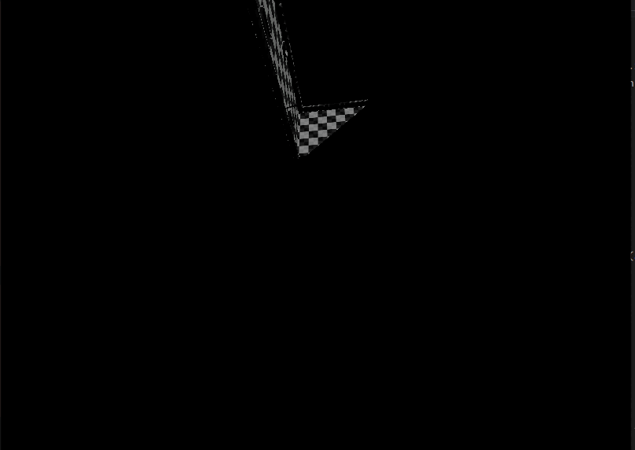
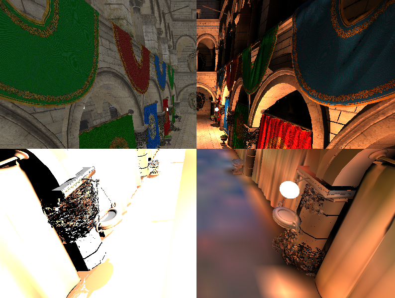
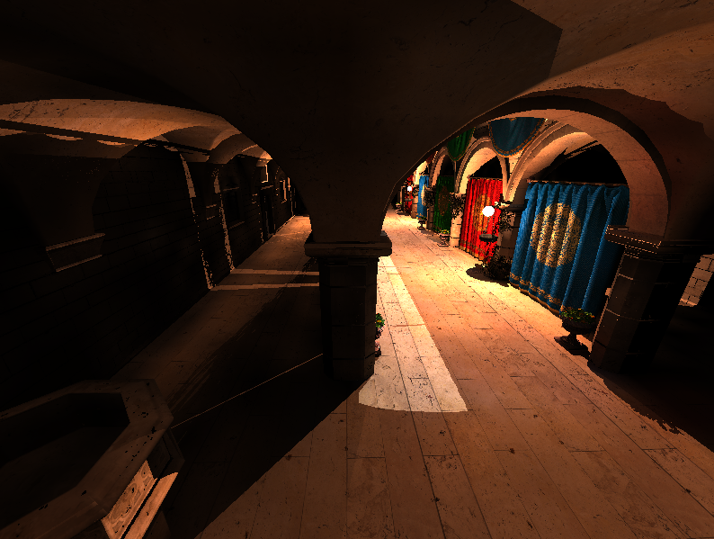

Engine is not Compatible with Apple software.
Might be possible if compatability mode is changed to true but this is untested.

CONTROLS:
Mouse for camera \
WASD to move around \
Scroll to change speed

Ray tracing, currently no GI and imported textures are not used

 

Four way split between \
Albedo, Combined \
Direct, Indirect

And only the combined light from 3d Radiance cascades \
Performance is only about 10 fps on gtx 1070 with static scene \
Cascades take about 12ms to compute

